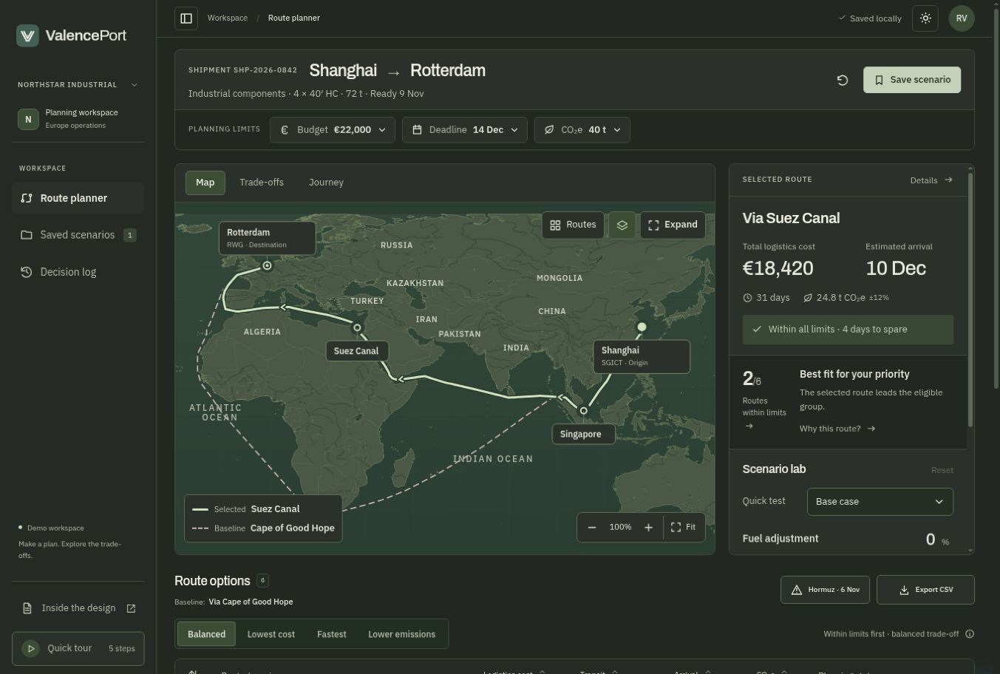
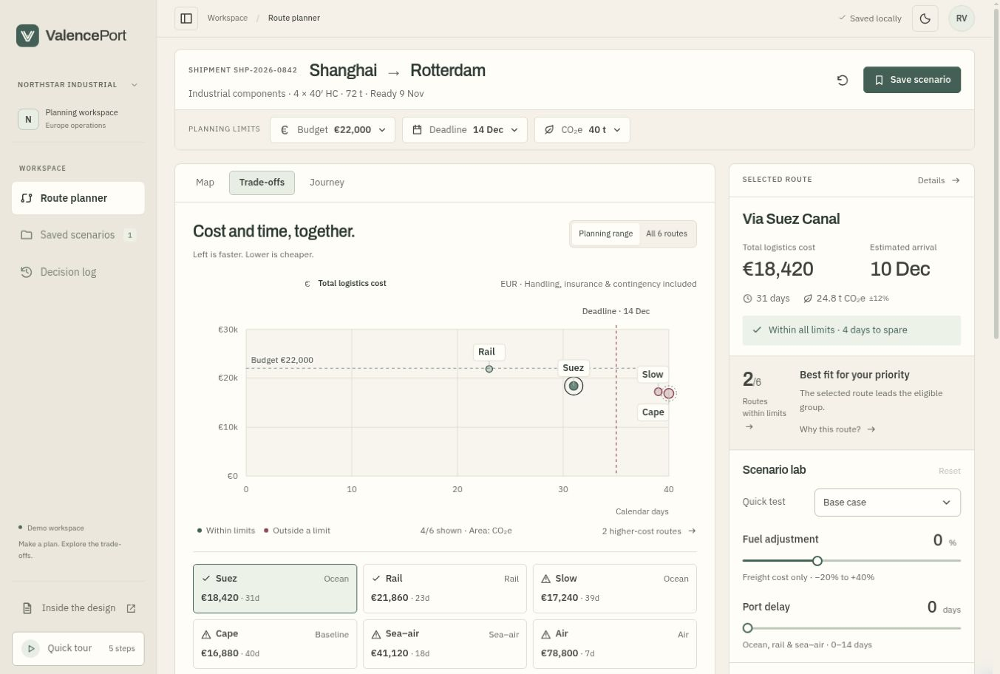
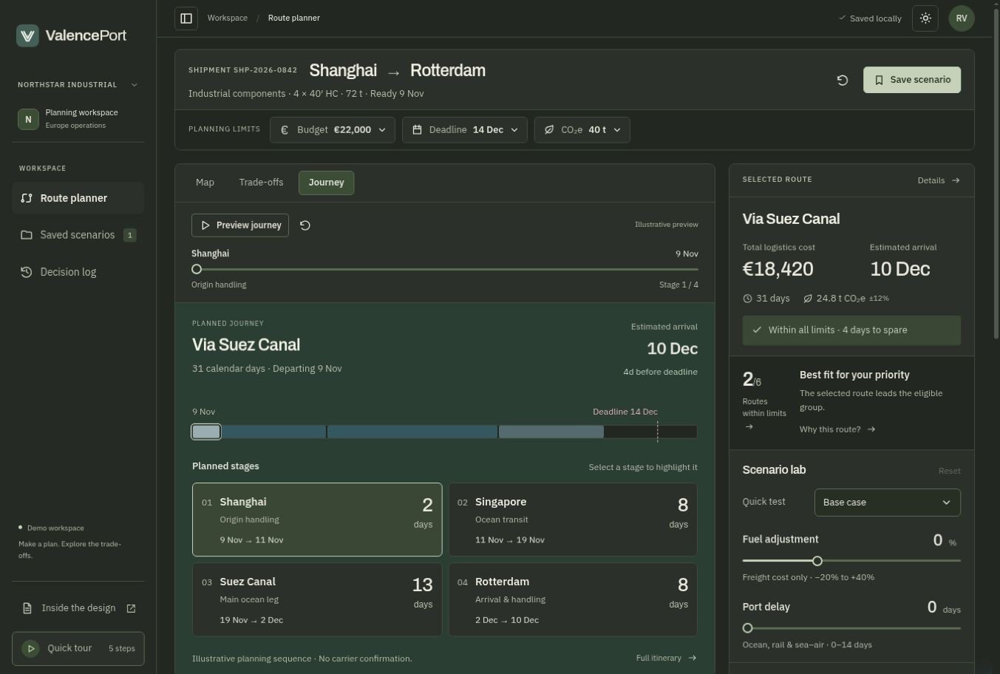
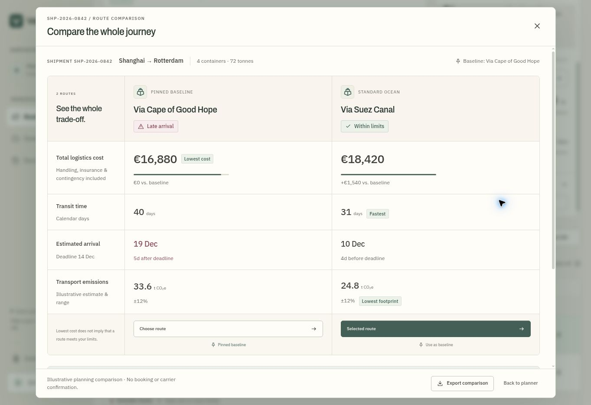
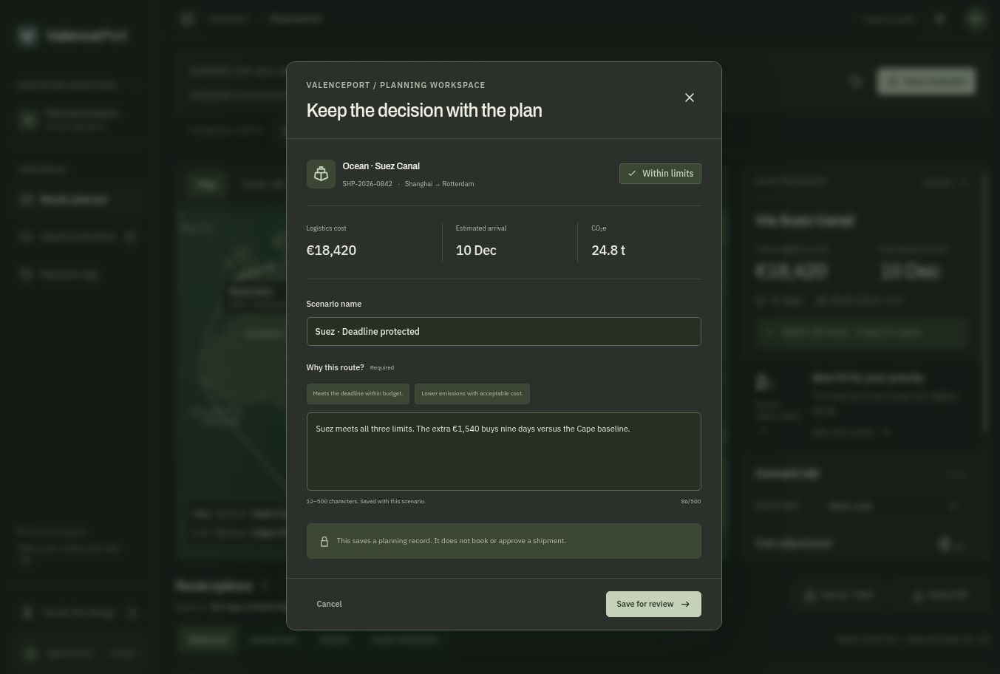
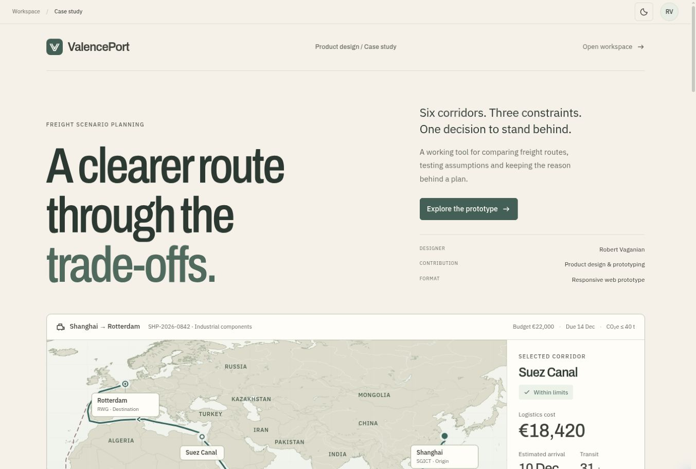

<div align="center">

  <picture>
    <source media="(prefers-reduced-motion: reduce)" srcset="docs/brand/valenceport-mark.png">
    
  </picture>

  # ValencePort

  **A clearer route forward.**

  Freight scenario planning · Product design & working prototype  
  Designed by **Robert Vaganian**

  [](package.json)
  [](dist/app.js)
  [](package.json)
  [](package.json)
  [](tests/)

  [Open the prototype](https://robertvaganian.github.io/valenceport/) ·
  [Case study](https://robertvaganian.github.io/valenceport/case-study/) ·
  [Run locally](#run-locally) ·
  [Design decisions](#design-decisions)

</div>

---

A lower quote can hide a worse plan. ValencePort compares six ways to move the same Shanghai–Rotterdam shipment across **cost, arrival and transport emissions**, then lets a planner test the assumptions and keep the reason behind a choice.

The starting plan costs **€16,880** but arrives **five days late**. The Suez alternative costs **€1,540 more**, arrives **nine days earlier** and meets all three planning limits. That is the decision the interface needs to make clear.

## The workspace

Six views from the working prototype, in light and dark themes. Select any screen to inspect it at full size.

<table>
  <tr>
    <td width="50%" valign="top">
      <strong>01 · Route planning</strong><br><br>
      <a href="docs/screenshots/01-planner-dark.jpg"></a><br>
      <sub>Map the selected corridor against its baseline.</sub>
    </td>
    <td width="50%" valign="top">
      <strong>02 · Cost and time</strong><br><br>
      <a href="docs/screenshots/02-tradeoffs-light.jpg"></a><br>
      <sub>See the deadline, budget and emissions trade-off.</sub>
    </td>
  </tr>
  <tr>
    <td width="50%" valign="top">
      <strong>03 · Planned journey</strong><br><br>
      <a href="docs/screenshots/03-journey-dark.jpg"></a><br>
      <sub>Inspect the stages behind an arrival estimate.</sub>
    </td>
    <td width="50%" valign="top">
      <strong>04 · Compare alternatives</strong><br><br>
      <a href="docs/screenshots/04-comparison-light.jpg"></a><br>
      <sub>Read costs, arrival and emissions side by side.</sub>
    </td>
  </tr>
  <tr>
    <td width="50%" valign="top">
      <strong>05 · Preserve the rationale</strong><br><br>
      <a href="docs/screenshots/05-rationale-dark.jpg"></a><br>
      <sub>Keep the assumptions and reason with the plan.</sub>
    </td>
    <td width="50%" valign="top">
      <strong>06 · Inside the design</strong><br><br>
      <a href="docs/screenshots/06-case-study-light.jpg"></a><br>
      <sub>Explore the product decisions in an interactive case study.</sub>
    </td>
  </tr>
</table>

## A planning session

1. **Set the limits.** Keep budget, deadline and emissions visible beside the shipment.
2. **Find the eligible routes.** Compare ocean, rail, sea–air and air options. Priority controls rank the routes within each eligibility group.
3. **Inspect the compromise.** Select a corridor on the map, compare up to three options, or inspect its journey stages. A pinned baseline gives the differences a consistent reference.
4. **Test the assumptions.** Adjust fuel cost and port delay. The inspector shows what changed for the same route, including when it stops meeting the limits.
5. **Save the reasoning.** Name an eligible scenario and explain the choice. Reopen its assumptions later, or export a comparison, brief or JSON backup.

For example, adding seven days of port delay moves the Suez arrival from 10 to 17 December. It misses the 14 December deadline; the Middle Corridor remains eligible. The recommendation follows the changed constraints.

## Design decisions

### Eligibility comes before preference

The cheapest or fastest option may still break the plan. The table separates routes within limits from those outside them, then sorts each group by the chosen priority. Selection, comparison and the pinned baseline have distinct controls.

### The map carries the geography

A self-hosted vector base stays sharp while zooming. Sea, rail, road and air legs retain different line styles; gaps in recorded observations remain gaps. Smooth camera movement, route reveals and a full-map view help people follow a corridor without losing their place.

### A saved plan keeps its context

Saving preserves the route, constraints, assumptions, baseline and explanation together. Fuel and delay impact remain separate from baseline comparisons, so two different kinds of change are not mixed into one number.

IBM Plex Sans supports the dense interface; Archivo gives the headings their compact character. Warm stone surfaces, restrained status tones and light and dark themes share one visual system. Motion respects reduced-motion preferences.

## Run locally

Requires **Node.js 22 or newer**. No dependency installation, API key or account is needed.

```sh
npm run dev
```

Open **http://127.0.0.1:8080**. The interactive case study is at **http://127.0.0.1:8080/case-study/**.

```sh
npm run check
```

This checks JavaScript syntax and runs the 84 behavior tests. Serve the app through HTTP; opening `dist/index.html` directly does not load its modules correctly.

<details>
<summary><strong>Implementation, calculations and data sources</strong></summary>

The application uses HTML, CSS and JavaScript modules with no runtime package dependencies. The `dist/` directory contains the editable application, not an opaque generated bundle.

| Area | Entry points |
| --- | --- |
| Shipment data, calculations and ranking | [`dist/model.mjs`](dist/model.mjs) |
| Map, geometry and camera movement | [`dist/route-map.mjs`](dist/route-map.mjs), [`dist/map-camera.mjs`](dist/map-camera.mjs) |
| Fuel and delay assumptions | [`dist/scenario-lab.mjs`](dist/scenario-lab.mjs) |
| Saved records and backup validation | [`dist/workspace-model.mjs`](dist/workspace-model.mjs) |
| Interactive product design case study | [`dist/case-editorial.mjs`](dist/case-editorial.mjs) |

Checks cover ranking, calculations, saved snapshots, import validation, geography, route continuity, complete reveals and text/status contrast. See the [implementation notes](docs/implementation.md) for calculation rules and model boundaries.

Geography uses Natural Earth. Sea legs use SeaRoute; cached rail and road geometry comes from OpenStreetMap-based routing. Air connections are indicative; the optional historical flight example preserves observation gaps. See [route provenance](docs/corridor-provenance.md) and [track notes](dist/assets/tracks/README.md).

</details>

## Scope and credits

A self-initiated portfolio concept by **[Robert Vaganian](https://github.com/RobertVaganian)**. Shipment records, prices, durations and emissions are illustrative. The prototype does not retrieve live rates, book freight or certify an operational route. Saved scenarios stay in the current browser unless exported.

The case study explains design decisions and interface validation. No user research results or measured business impact are claimed.

Natural Earth is public domain. SeaRoute uses Apache 2.0; OSM-derived network data and ADSB.lol observations use ODbL 1.0. Credits are included with the [route data](dist/assets/tracks/README.md); the self-hosted fonts include their [OFL licenses](dist/assets/fonts/README.md).


